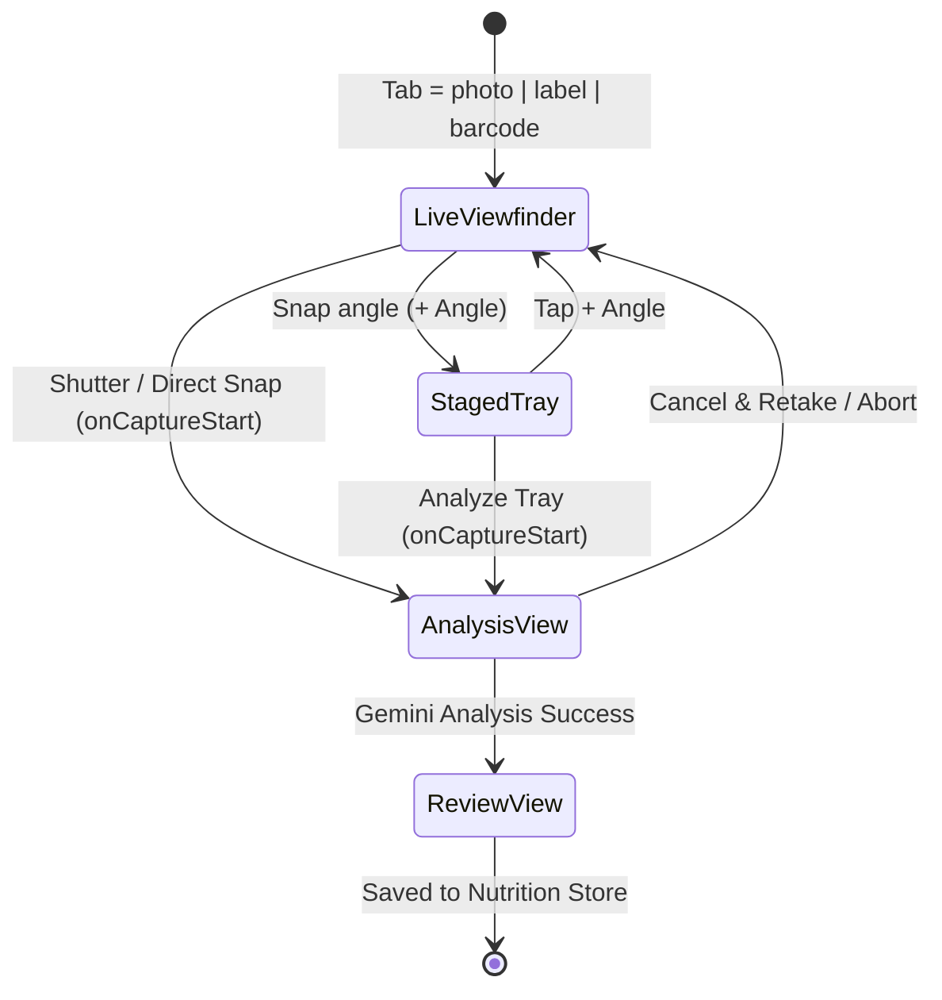

# Architecture — CalorieSnap Pro

> **Last Reviewed:** 2026-10-17 | **Git Revision:** `2f87a3e` (`main`) | **Test Suite:** 54/54 Passing (`npm test`)

---

## 1. UI, Viewport & Camera Lifecycle Architecture

### Root Shell & Web Viewport ([`src/App.js`](file:///g:/calorie%20meter/src/App.js))
- **Web CSS Injection**: On `Platform.OS === 'web'`, `App.js` injects a `<style id="expo-web-root-styles">` tag into `document.head` setting `html, body, #root { height: 100%; margin: 0; background-color: #121214; display: flex; flex-direction: column; overflow: hidden; }`.
- **Centered Mobile Shell**: On web, `App.js` constrains the app inside `styles.mobileShell` (`maxWidth: 460`, `width: '100%'`, `alignSelf: 'center'`, subtle borders `rgba(255,255,255,0.06)`, box-shadow `0 0 50px rgba(0,0,0,0.8)`).
- **Safe Area & Error Wrapping**:
  ```text
  <SafeAreaProvider initialMetrics={initialWindowMetrics}>
    <ErrorBoundary>
      <AppBootstrapper />
    </ErrorBoundary>
  </SafeAreaProvider>
  ```

### Custom State-Switched Navigation ([`src/navigation/TabNavigator.js`](file:///g:/calorie%20meter/src/navigation/TabNavigator.js))
- Instead of `@react-navigation`, `TabNavigator` maintains `const [activeRoute, setActiveRoute] = useState('Dashboard')` and renders `<ActiveComponent navigation={{ navigate: (route) => handleTabPress(route) }} />`.
- **Consequence**: Switching tabs **unmounts** the previous screen and **mounts** the new screen. Persistent state across tab switches MUST live in Zustand stores (`useNutritionStore`, `useProfileStore`, `useAIStore`) or database tables—never in screen-local `useState`.
- **Tab Bar Visibility & Safe Area Math**:
  - `bottomPad = Math.max(insets.bottom, 8)`
  - `tabBarHeight = 56 + bottomPad`
  - `hideTabBar = activeRoute === 'LogMeal' || isKeyboardVisible` (full-screen capture on `LogMealScreen`, and hidden when keyboard opens).
  - Center `+` button (`route.isCenterAction` for `'LogMeal'`) is elevated (`top: -12`, `48x48` circle in `colors.sagePrimary`) with spring press scale.

### Camera Viewport & Capture Lifecycle ([`src/screens/LogMealScreen.js`](file:///g:/calorie%20meter/src/screens/LogMealScreen.js), [`src/components/CameraScanner.js`](file:///g:/calorie%20meter/src/components/CameraScanner.js))
The camera capture subsystem uses an explicit two-view state machine to avoid keeping heavy camera hardware active during AI analysis:



1. **Instant Camera Unmount (`onCaptureStart`)**:
   - The moment the hardware camera captures a frame (`takePictureAsync`), `CameraScanner` / `NutritionLabelScanner` invokes `onCaptureStart(photo.uri)`.
   - `LogMealScreen` immediately sets `isProcessing = true`, stores `capturedImageUri`, and increments `barcodeReqIdRef.current` to record `pendingCaptureId.current`.
   - Because `isCameraMode && isProcessing` evaluates to false for the live viewfinder, `<CameraScanner>` / `<CameraView>` **unmounts immediately**, releasing GPU and camera hardware before on-device image compression and upload begin.
2. **Dedicated Captured Photo Analysis View**:
   - Replaces the camera with a dedicated fullscreen view:
     - Header with Back button.
     - Framed photo preview of the captured shot with green corner brackets and multi-plate count pill (`{capturedImageUris.length} Plates Captured`).
     - Animated laser scan beam (`scanAnim` looping `0 <-> 1` over 1800ms) sweeping vertically across the preview box.
     - Status card with badge (`GEMINI VISION AI`), large activity spinner, title, dynamic status message, and **Cancel & Retake** button.
3. **Cancel & Retake Mechanics**:
   - Tapping **Cancel & Retake** calls `handleCancelProcessing()`, incrementing `barcodeReqIdRef.current` and resetting `isProcessing: false`. Any in-flight Gemini request is silently dropped when its promise resolves.
   - If user cancels while image resizing is running, `consumeCancelledCapture()` returns true, preventing the subsequent `handleCapturePhoto` hand-off from initiating Gemini inference.
4. **Tray Mode Optimization**:
   - When 1 or more photos are staged in the tray, `<CameraScanner>` renders a frozen preview card. The live `<CameraView>` is unmounted until the user explicitly taps `+ Angle` (`isAddingAngle = true`).

---

## 2. State Management & Concurrency Architecture

### Store 1: `useNutritionStore` ([`src/stores/useNutritionStore.js`](file:///g:/calorie%20meter/src/stores/useNutritionStore.js))
- **Single Source of Truth for Selected Date**:
  - Holds `selectedDate` (initialized to `getTodayString()`, local `YYYY-MM-DD`).
  - `setSelectedDate(date)` validates via `validateDate(date)`, rejects future dates, resets items to zero, and calls `refreshData(date)`.
- **Out-of-Order Race Guard (`refreshRequest`)**:
  - Module-level counter `let refreshRequest = 0;`.
  - Every `refreshData(dateOverride)` call increments `const request = ++refreshRequest;`.
  - Stale responses are discarded:
    ```js
    if (request !== refreshRequest || targetDate !== get().selectedDate) return;
    ```
- **Cross-Component Reactivity (`dataRevision`)**:
  - Every completed `refreshData()` increments `dataRevision: state.dataRevision + 1`.
  - `<WeeklyTrendsCard />` subscribes to `dataRevision` and refetches `get7DaySummary(selectedDate)` whenever either `selectedDate` or `dataRevision` changes.
- **Computed `dailyTotals` Formula**:
  ```js
  netCalories = Math.round(totalCalories - caloriesBurned)
  ```
  `<CalorieRing />` computes remaining budget as:
  ```js
  remaining = goal + burned - consumed
  ```

### Store 2: `useProfileStore` ([`src/stores/useProfileStore.js`](file:///g:/calorie%20meter/src/stores/useProfileStore.js))
- **`calculateMetabolism(profile)` Pure Formula**:
  1. Sanitizes inputs with fallbacks (`weight_kg: 70`, `height_cm: 175`, `age: 25`, `gender: 'male'`).
  2. **Mifflin-St Jeor BMR**:
     - Male: `10 * weight + 6.25 * height - 5 * age + 5`
     - Female: `10 * weight + 6.25 * height - 5 * age - 161`
  3. **TDEE Multipliers (5 Activity Levels)**:
     - `sedentary`: `1.2`, `light`: `1.375`, `moderate`: `1.55`, `active`: `1.725`, `very_active`: `1.9`.
  4. **Goal Adjustment**:
     - `lose_weight`: `Math.max(1200, tdee - 500)`
     - `gain_muscle`: `tdee + 350`
     - `maintain`: `tdee`
  5. **Macro Split**:
     - `suggestedProtein = Math.round(weight * 2.0)` (`4 kcal/g`)
     - `suggestedFat = Math.round((targetCalories * 0.28) / 9)` (`9 kcal/g`)
     - `suggestedCarbs = Math.round(Math.max(200, targetCalories - proteinCals - fatCals) / 4)` (`4 kcal/g`)
     - `suggestedWater = Math.round(weight * 35)` (`ml`)
- **Atomic Profile + Goal Persistence**:
  - `saveProfile(newProfile, autoUpdateGoals = false)`: When `autoUpdateGoals === true` (used in `SettingsScreen`), calls `updateProfileAndGoals(mergedProfile, suggestedGoals)` so both tables update atomically in a single transaction.

### Store 3: `useAIStore` ([`src/stores/useAIStore.js`](file:///g:/calorie%20meter/src/stores/useAIStore.js))
- **Stale Response Guard (`conversationVersion`)**:
  - Module-level `let conversationVersion = 0;`.
  - `clearChat()` increments `conversationVersion++` and resets generating states.
  - In-flight `sendUserMessage`, `requestDailyReview`, and `requestMealPlan` check `if (version !== conversationVersion) return;` and discard late responses if chat was cleared or reset.
- **Context Windowing**:
  - UI preserves up to `40` messages (`currentMessages.slice(-40)`).
  - API payload sends the last `16` completed messages (`currentMessages.slice(-16)`) to `sendNutritionistChatMessage` to bound token usage.

### Modal & Screen Concurrency Ref-Locks
| Component / Screen | Concurrency Refs | What They Protect |
| :--- | :--- | :--- |
| [`LogMealScreen.js`](file:///g:/calorie%20meter/src/screens/LogMealScreen.js) | `barcodeReqIdRef` (counter), `pendingCaptureId` (ref), `saveLock` (boolean) | Drops late photo/label/barcode/text responses when user switches tabs, retakes, or cancels; prevents duplicate `handleSaveMeal` executions. |
| [`QuickAddModal.js`](file:///g:/calorie%20meter/src/components/QuickAddModal.js) | `session` (counter), `operationPending` (boolean) | Increments `session.current` on prop changes or modal close; drops late AI macro estimation responses. |
| [`AddExerciseModal.js`](file:///g:/calorie%20meter/src/components/AddExerciseModal.js) | `estimateRequest` (counter), `savePending` (boolean) | Drops stale AI workout estimates when user edits prompt or closes modal. |
| [`BarcodeScanner.js`](file:///g:/calorie%20meter/src/components/BarcodeScanner.js) | `scanLock` (boolean), `lookupPending` (boolean) | Prevents repeated camera scan triggers until user explicitly taps `"Scan Again"`. |
| [`MealPlanCard.js`](file:///g:/calorie%20meter/src/components/MealPlanCard.js) | `saving` (boolean) | Prevents concurrent duplicate taps on `"Log This Meal"` buttons. |

---

## 3. Dual-Engine Persistence & Image Storage

### Database Schema ([`src/services/databaseService.js`](file:///g:/calorie%20meter/src/services/databaseService.js))
- **Native Engine**: `SQLite.openDatabaseAsync('caloriesnap.db')` with `PRAGMA journal_mode = WAL`.
- **Web Engine**: `localStorage.getItem('caloriesnap_web_db_v1')` serialized JSON structure with deep cloning and rollback on quota errors.

| Table | Primary Key | Columns & Types |
| :--- | :--- | :--- |
| `user_profile` | `id = 1` (singleton) | `name TEXT`, `gender TEXT`, `age INTEGER`, `weight_kg REAL`, `height_cm REAL`, `activity_level TEXT`, `goal_type TEXT`, `custom_api_key TEXT`, `updated_at TEXT` |
| `daily_goals` | `id = 1` (singleton) | `calories INTEGER`, `protein INTEGER`, `carbs INTEGER`, `fat INTEGER`, `water_ml INTEGER`, `exercise_minutes INTEGER`, `updated_at TEXT` |
| `meals` | `id INTEGER AUTOINCREMENT` | `date TEXT`, `meal_type TEXT`, `name TEXT`, `portion TEXT`, `calories REAL`, `protein REAL`, `carbs REAL`, `fat REAL`, `fiber REAL`, `sugar REAL`, `sodium REAL`, `health_score REAL`, `confidence REAL`, `image_uri TEXT`, `ingredients TEXT`, `dietary_tags TEXT`, `health_tips TEXT`, `is_water INTEGER`, `water_ml REAL`, `logged_at TEXT` |
| `water_intake` | `id INTEGER AUTOINCREMENT` | `date TEXT`, `amount_ml INTEGER`, `logged_at TEXT` |
| `exercises` | `id INTEGER AUTOINCREMENT` | `date TEXT`, `name TEXT`, `category TEXT`, `duration_minutes REAL`, `calories_burned REAL`, `intensity TEXT`, `notes TEXT`, `logged_at TEXT` |
| `settings` | `key TEXT PRIMARY KEY` | `value TEXT` |

### Image Storage Lifecycle ([`src/services/imageService.js`](file:///g:/calorie%20meter/src/services/imageService.js))
1. **Save (`persistImageAsync(tempUri)`)**:
   - **Native**: Copies temporary camera file into `FileSystem.documentDirectory + 'meals/meal_{timestamp}_{rand}.{ext}'`.
   - **Web**: Stores `Blob` in IndexedDB (`CalorieSnapImagesDB`, store `meal_images`, 10MB limit) and returns synthetic key `indexeddb://img_{timestamp}_{rand}`.
2. **Render (`resolveImageUriAsync(uri)`)**:
   - In [`MealCard.js`](file:///g:/calorie%20meter/src/components/MealCard.js), on web, reads `Blob` from IndexedDB and creates `URL.createObjectURL(blob)`, revoking it on unmount.
3. **Delete & Cleanup**:
   - `LogMealScreen`: If `persistImageAsync` succeeds but `addMeal` throws, immediately deletes the persisted image.
   - `updateMeal` / `deleteMealById`: Checks if any other meal still references `image_uri` before calling `deletePersistedImageAsync`.

---

## 4. External API Pipelines

### Google Gemini Pipeline ([`src/services/geminiService.js`](file:///g:/calorie%20meter/src/services/geminiService.js))
- **Model Configuration**:
  - `PRIMARY_MODEL = 'gemini-3.5-flash-lite'`
  - `FALLBACK_MODEL = 'gemini-flash-lite-latest'`
  - `CHAT_MODEL = 'gemini-3.5-flash-lite'`
- **Fast Thinking Configuration**:
  - Sub-second inference: Passes `generationConfig.thinkingConfig: { thinkingBudget: 0 }`.
  - If a model rejects this config (`HTTP 400` with `'thinking'` in error), sets `thinkingConfigUnsupported = true` and immediately retries without thinkingConfig.
- **Two-Pass Lenient Vision Policy**:
  - First pass sends meal photos with `FOOD_ANALYSIS_SCHEMA`.
  - `isGenuineNoFood(parsed)` verifies if the result is truly non-food (ignoring cases where the model sets `is_no_food: true` while still returning a valid food name and calories > 0).
  - If non-food is reported, automatically executes a second, more lenient pass instructing the model that the photo may be dim or angled.
  - Only if the second pass also reports no food does it throw a tagged `Error('No food detected...')` with `error.code = 'NO_FOOD'`.
- **Dynamic Rate Limiter**:
  - 60 RPM for custom API key, 15 RPM for shared key.
  - Internal retries (fallback model, fast-mode rejection, lenient vision retry) pass `isRetry: true`, which bypasses token deduction so retries never deplete the user's rate-limit budget.

### OpenFoodFacts Pipeline ([`src/services/barcodeService.js`](file:///g:/calorie%20meter/src/services/barcodeService.js), [`src/services/barcodeNutrition.js`](file:///g:/calorie%20meter/src/services/barcodeNutrition.js))
- Validates 8-14 digit barcode.
- Queries `https://world.openfoodfacts.org/api/v2/product/{code}.json` with `15,000ms` `AbortController` timeout.
- Normalizes nutrition: prefers `*_serving` when serving weight is available; scales `*_100g` otherwise; converts `energy` kJ (`kJ / 4.184`) when `energy-kcal` is missing; calculates sodium from salt.

### Notification Subsystem ([`src/services/notificationService.js`](file:///g:/calorie%20meter/src/services/notificationService.js))
- **Android Channel Configuration**:
  - Creates high-importance channel `'reminders'` with `importance: AndroidImportance.HIGH`, light `#6B9B7D`, vibration `[0, 250, 250, 250]`.
  - Must exist before requesting permissions (Android 13+) and before scheduling triggers.
- **4 Daily Triggers**:
  - Breakfast (`8:30 AM`), Lunch (`1:15 PM`), Hydration (`4:30 PM`), Dinner/Review (`7:45 PM`).
- **First Launch Initialization**:
  - `ensureRemindersOnFirstLaunch()` runs after app bootstrap. If notification permissions are undetermined, requests permission and schedules reminders; if already granted with 0 scheduled items, schedules them automatically.
- **Instant Test Verification**:
  - `sendTestNotification()` allows immediate verification from `SettingsScreen`.
