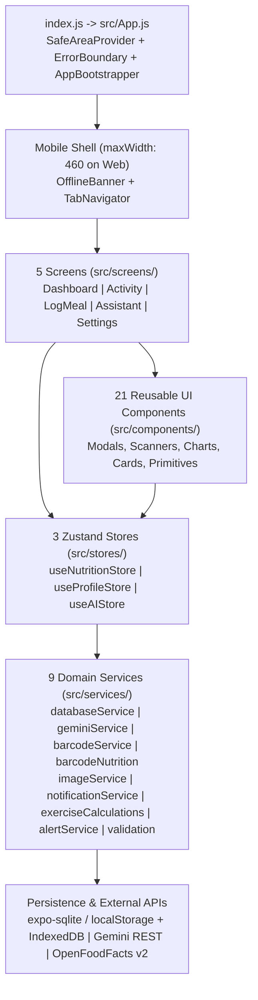

# Project Overview — CalorieSnap Pro

> Historical baseline below. The 19 October scan architecture and verification supersede its counts, capture lifecycle, and streaming claims: see [PROJECT_SKILL](PROJECT_SKILL.md) and [verification](../../VERIFICATION_2026-10-19.md). Chat uses progressive display after receiving a complete response.

> **Last Reviewed:** 2026-10-17 | **Git Revision:** `2f87a3e` (`main`) | **Test Suite:** 54/54 Passing (`npm test`)

---

## 1. Project Purpose & Capabilities

**CalorieSnap Pro** is an offline-first, AI-powered cross-platform nutrition, hydration, and fitness tracking application built with **React Native (Expo SDK 57)** for **Android, iOS, and Web**.

### Core Capabilities

1. **5-Mode Meal Logging ([`src/screens/LogMealScreen.js`](file:///g:/calorie%20meter/src/screens/LogMealScreen.js))**:
   - **Food Photo AI (`photo`)**: Single or multi-angle (up to 4 photos) food photography with Pakistani/South Asian/Global cuisine specialization and time-of-day meal period detection (`getCurrentMealPeriod`). On-device optimization (`896px`, JPEG `0.62`) yields ~85KB uploads. Shutter press immediately unmounts live `<CameraView>` and transitions to a dedicated **Captured Photo Analysis View** with framed photo preview, animated laser scan beam, live progress messages, and a **Cancel & Retake** button. Uses `gemini-3.5-flash-lite` with two-pass lenient vision retry (`isGenuineNoFood`) before raising a tagged `NO_FOOD` error (which offers Retake or direct switch to Describe). Automatically routes plain water photos (`isPlainWater`) to hydration.
   - **Nutrition Facts Label OCR (`label`)**: Rectangular guide frame, optimized at `1600px` (`0.82` JPEG) to capture fine table print, parsed via `analyzeNutritionLabel`. Non-label photos are rejected with actionable guidance.
   - **Barcode Scanner (`barcode`)**: Live camera barcode scanning (`EAN-13`, `UPC-A`, etc.) with numeric manual input fallback, querying **OpenFoodFacts v2** (`lookupBarcode`). Normalizes per-serving vs per-100g, converts `kJ` to `kcal`, and locks until user taps `"Scan Again"`.
   - **Natural Language AI (`text`)**: Natural language and Roman Urdu meal descriptions parsed into structured macros via `parseMealDescription`.
   - **Manual Quick Add / Edit (`manual` tab & `QuickAddModal`)**: Direct macro inputs with one-tap AI estimation (`"Auto-Calculate Macros with AI"`). Automatically preserves existing image URIs and micronutrients on edit.
2. **Activity & Exercise Tracking ([`src/screens/ActivityScreen.js`](file:///g:/calorie%20meter/src/screens/ActivityScreen.js), [`src/components/AddExerciseModal.js`](file:///g:/calorie%20meter/src/components/AddExerciseModal.js))**:
   - **Walking Calculator**: Calculates calories burned, step count, or duration across 4 paces (`casual`, `moderate`, `brisk`, `incline`) using body-weight MET formulas (`walkingStats`).
   - **20 Workout Presets**: Categorized into `cardio`, `strength`, `sports`, and `flexibility` (`PRESETS`), scaled by user weight, duration, and intensity (`low 0.85x`, `moderate 1.0x`, `high 1.2x`).
   - **AI Workout Estimator**: Free-text workout descriptions parsed with user weight via Gemini (`estimateExerciseFromText`).
3. **AI Nutritionist Coach ([`src/screens/AssistantScreen.js`](file:///g:/calorie%20meter/src/screens/AssistantScreen.js))**:
   - Multi-turn streaming chat (`sendNutritionistChatMessage`) using `gemini-3.5-flash-lite` with live context injection of profile, macro goals, logged meals, and net calories (factoring in exercise burn).
   - **1-Tap AI Daily Review (`generateDailyReview`)**: Evaluates logged meals and macro totals against goals for the selected date.
   - **Structured AI Meal Planner (`generatePersonalizedMealPlan`)**: Generates 4-meal daily plans (`breakfast`, `lunch`, `dinner`, `snack`) matching targets, rendered in interactive `<MealPlanCard />` components with 1-tap `"Log This Meal"` buttons.
4. **Metabolic Engine & Hydration ([`src/stores/useProfileStore.js`](file:///g:/calorie%20meter/src/stores/useProfileStore.js), [`src/components/WaterTracker.js`](file:///g:/calorie%20meter/src/components/WaterTracker.js))**:
   - Calculates **BMR** (Mifflin-St Jeor), **TDEE** across 5 activity levels (`sedentary: 1.2`, `light: 1.375`, `moderate: 1.55`, `active: 1.725`, `very_active: 1.9`), and daily macro targets (`2.0g/kg` protein, `28%` fat calories, remaining carbs with a `200 kcal` floor, `35ml/kg` water).
   - Interactive animated liquid vial `<WaterTracker />` with `+250ml`, `+500ml`, and last-entry undo (`removeRecentWaterIntake`).
5. **Smart Notification Reminders ([`src/services/notificationService.js`](file:///g:/calorie%20meter/src/services/notificationService.js))**:
   - Android high-importance notification channel `'reminders'` with custom vibration and `#6B9B7D` light color.
   - 4 daily schedule triggers: Breakfast (`8:30 AM`), Lunch (`1:15 PM`), Hydration (`4:30 PM`), Dinner & Review (`7:45 PM`).
   - Automatic first-launch opt-in (`ensureRemindersOnFirstLaunch`) and test notification trigger in Settings.
6. **7-Day Analytics & Data Portability ([`src/components/WeeklyTrendsCard.js`](file:///g:/calorie%20meter/src/components/WeeklyTrendsCard.js), [`src/screens/SettingsScreen.js`](file:///g:/calorie%20meter/src/screens/SettingsScreen.js))**:
   - Interactive 7-day bar chart with average intake badge, goal line, and clickable bars that jump `selectedDate` to the tapped day.
   - Full JSON backup export (`exportAllDataJSON`), transactional restore (`importAllDataJSON`) with schema validation, and factory reset (`factoryResetAllData`).

---

## 2. Repository Boundary: Active App vs. Legacy Prototype

> [!IMPORTANT]
> The repository root contains **two distinct codebases**. Always target the **Active React Native / Expo App** (`src/`, `tests/`) unless explicitly instructed to touch the legacy Python prototype.

| Attribute | Active Production App (Primary) | Legacy Desktop Prototype (Inactive) |
| :--- | :--- | :--- |
| **Location** | `src/`, `tests/`, `index.js`, `app.json`, `package.json` | Root Python files (`main.py`, `database.py`, `ai_manager.py`, `ui/`) |
| **Tech Stack** | React Native `0.86.3`, Expo `~57.0.25`, React `19.2.3`, Zustand `^5.0.0` | Python 3, CustomTkinter, Pillow, `google-genai`, `sqlite3` |
| **Storage** | Native: `expo-sqlite` (`caloriesnap.db`) / Web: `localStorage` (`caloriesnap_web_db_v1`) | Local SQLite files (`calorie_tracker.db`, `nutrition_data.db`) |
| **Tests** | `npm test` -> `node --test tests/*.test.js` (54 tests across 6 test suites) | `test_app.py`, `verify_ui.py` |

---

## 3. Technology Stack & Dependencies (`package.json`)

| Category | Package / Tool | Version | Role in Application |
| :--- | :--- | :--- | :--- |
| **Core Runtime** | `expo` | `~57.0.25` | Cross-platform app runtime & Metro bundler |
| **UI Framework** | `react` / `react-native` | `19.2.3` / `0.86.3` | Component model, Animated API, StyleSheet |
| **Web Support** | `react-dom` / `react-native-web` | `19.2.3` / `~0.21.0` | DOM rendering for Expo Web (`maxWidth: 460` mobile shell) |
| **State Management** | `zustand` | `^5.0.0` | 3 reactive stores (`useNutritionStore`, `useProfileStore`, `useAIStore`) |
| **Database** | `expo-sqlite` | `^56.0.10` | Native SQLite engine (`openDatabaseAsync('caloriesnap.db')`, WAL mode) |
| **File System** | `expo-file-system` (`/legacy`) | `^56.0.11` | Native image persistence (`documentDirectory/meals/`) |
| **Camera / Scanner** | `expo-camera` | `^56.0.13` | `<CameraView />` for food photos, nutrition labels, and barcodes |
| **Image Processing** | `expo-image-manipulator` | `~56.0.9` | On-device resize & JPEG compression prior to Gemini upload |
| **Gallery / System Cam**| `expo-image-picker` | `^56.0.14` | Multi-image library selection & OS system camera fallback |
| **Notifications** | `expo-notifications` | `~56.0.14` | Android high-importance channel & 4 daily reminders |
| **Graphics / Icons** | `react-native-svg` / `@expo/vector-icons` | `15.15.4` / `^15.0.2` | `<CalorieRing />` SVG arcs, `<WaterTracker />` wave, `Ionicons` |
| **Safe Area** | `react-native-safe-area-context` | `~5.7.0` | `<SafeAreaProvider>` & `useSafeAreaInsets()` across screens & tab bar |
| **Date Utilities** | `date-fns` | `^4.1.0` | Date formatting and manipulation (`format`, `parseISO`, `isToday`) |
| **Test Runner** | `node:test` + `@babel/core` | Built-in / `^7.29.0` | Runs production ES/JSX modules inside Node VM (`tests/load-production.cjs`) |

---

## 4. Major Subsystems & Architectural Layers

1. **Presentation Layer (`src/screens/`, `src/components/`, `src/navigation/`, `src/theme/`)**:
   - Single-active-screen state-switched navigation (`TabNavigator.js`).
   - "Warm Minimalism" dark theme (`src/theme/colors.js`).
   - Dedicated Captured Photo Analysis View in `LogMealScreen.js` completely replaces live camera during processing.
2. **State Layer (`src/stores/`)**:
   - `useNutritionStore`: Date-scoped logs (`meals`, `exercises`, `waterEntries`), computed `dailyTotals` (with `netCalories`), and `dataRevision` counter.
   - `useProfileStore`: User profile, macro goals, and Mifflin-St Jeor `calculateMetabolism` helper (5 activity levels).
   - `useAIStore`: Multi-turn chat state, streaming tokens, daily review, and meal planner with `conversationVersion` guards.
3. **Service & Persistence Layer (`src/services/`)**:
   - `databaseService.js`: Unified async CRUD over native SQLite and web `localStorage`.
   - `imageService.js`: Cross-platform image persistence (`documentDirectory/meals/` on native, IndexedDB on web).
   - `geminiService.js`: Gemini 3.5 client with fast inference (`thinkingLevel: 'MINIMAL'`), `INTEGER` schema fields, two-pass lenient vision retry, rate limiter (60/15 RPM) with retry deduplication protection.
   - `barcodeService.js` & `barcodeNutrition.js`: OpenFoodFacts v2 client with serving scaling and energy unit conversion.
   - `notificationService.js`: Android channel configuration, permissions, 4 daily triggers, and test notification.
   - `exerciseCalculations.js`: Pure calculations for walking METs, presets, and water volume.
   - `alertService.js`: Unified cross-platform alert and confirm dialogs.
   - `validation.js`: Domain entity sanitizers and normalizers.

---

## 5. Application Lifecycle

1. **Entry (`index.js` -> `src/App.js`)**:
   - `registerRootComponent(App)` mounts `<App />`.
   - On web, `App.js` injects `#expo-web-root-styles` into `document.head` to enforce `#121214` dark background and full-height layout.
2. **Bootstrap (`AppBootstrapper` in `src/App.js`)**:
   - Runs on mount:
     1. `await initDatabase()` — creates tables, runs migrations, seeds defaults.
     2. `await useProfileStore.getState().loadProfile()` — loads profile & goals, computes `bmr` and `tdee`.
     3. `await useNutritionStore.getState().refreshData(getTodayString())` — loads today's logs and computes `dailyTotals`.
     4. `await ensureRemindersOnFirstLaunch()` — non-blocking first-launch notification initialization.
   - While `isReady === false`, renders `<LoadingShimmer />`.
3. **Interactive Session**:
   - Renders `<OfflineBanner />` + `<TabNavigator />`.
   - All mutations flow through `validation.js` -> `databaseService.js` -> store `refreshData()`, incrementing `dataRevision` to keep mounted charts and summary rings synchronized.
